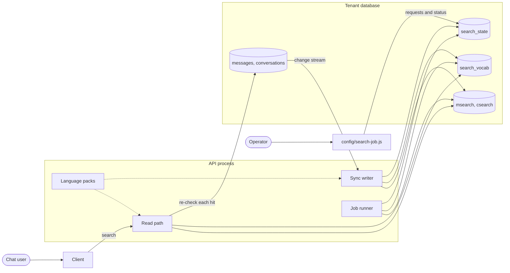

# Conversation search

Users search their own past messages and conversations, in Icelandic and English, and find a
word in any of its forms: `hestur` finds `hestinum`, `skattur` finds `tekjuskattur`, and `bornum`
finds `börnum`. Search runs inside the API process against the tenant's own database, so no
separate search service is needed.

It is off by default. With no `search` block in `librechat.yaml` nothing is loaded, nothing is
created and nothing is read.

## Pages

| Page                                 | Answers                                                                                   |
| ------------------------------------ | ----------------------------------------------------------------------------------------- |
| [how-it-works.md](how-it-works.md)   | How a message becomes searchable, how a search runs, and what the user sees when it fails |
| [data.md](data.md)                   | What is stored and what is not, the word list, and how long things stay                   |
| [jobs.md](jobs.md)                   | `config/search-job.js`, the backfill chain, reconcile and verify                          |
| [configuration.md](configuration.md) | The `search` block in `librechat.yaml` and the environment variables                      |
| [runbook.md](runbook.md)             | Step-by-step procedures for an operator: upgrade, backfill, cutover, rollback, retention  |

The specification, the design decisions and the review history are in
[`specs/001-conversation-search/`](../../specs/001-conversation-search/).

## The parts

## In one minute

- **Indexing.** One API process follows a change stream on `messages` and `conversations`. For
  each new or changed row it stores a search record: the row's words as tokens, never its text.
- **Searching.** A query is turned into tokens the same way, and the read path looks them up in
  the records. Every read is scoped to the user from the session, and every hit is checked
  against the live message before it is returned.
- **One writer.** Every API process can index, but only the one holding a lease in the database
  does. Another takes over within about 30 seconds if it stops.
- **Jobs.** The lease holder also runs the jobs: the first backfill, a reconcile that repairs
  what sync missed, and a verification that compares both sides.
- **Readiness.** The search box shows only after a verification has passed.
- **Languages.** All language knowledge sits behind a pack interface. Icelandic is a dictionary
  pack whose data is delivered outside this repository, and English is a stemmer pack.

## Where the code is

| Package                   | Holds                                                                                                                                      |
| ------------------------- | ------------------------------------------------------------------------------------------------------------------------------------------ |
| `packages/api/src/search` | The service and startup, the HTTP layer, the analyzer and language packs, the read path, the sync writer, the jobs and the metrics         |
| `packages/data-schemas`   | The four schemas and models, every database read and write (`methods/search.ts`), the record types                                         |
| `packages/data-provider`  | The `search` config schema, the error codes and response types, endpoints and query keys                                                   |
| `api/` and `config/`      | Route wiring, the two server entry points, and `config/search-job.js`                                                                      |
| `client`                  | The `/search` route, the search state components, the sidebar, Archived Chats, shared links, and the dictionary credit in Settings > About |

`api/` only wires. The behaviour is in `packages/api`, and the database access is in
`packages/data-schemas`, which takes and returns plain objects.
