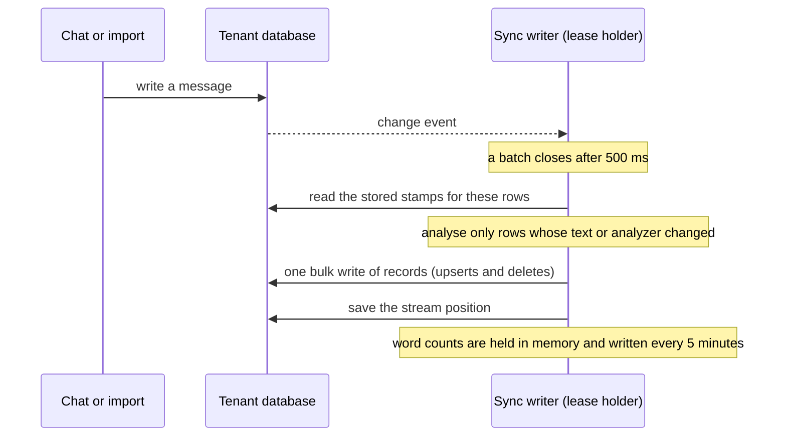
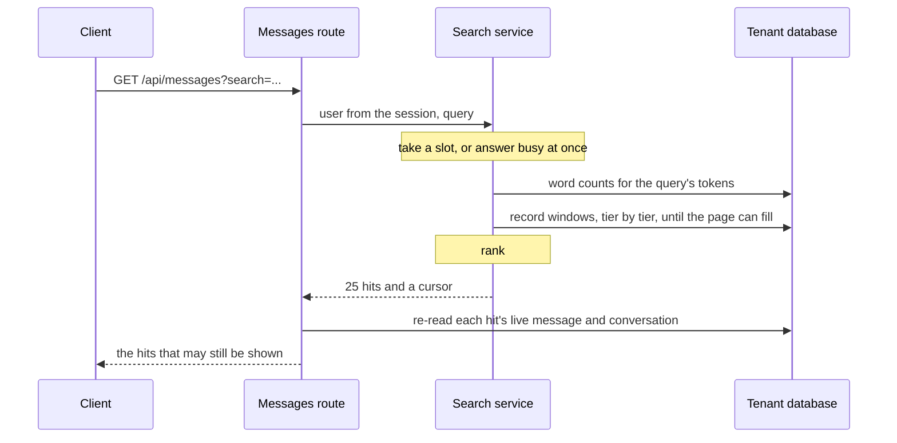

# How conversation search works

Back to the [overview](README.md).

## From text to tokens

The text of a message is its text, thinking and steer parts. Tool output, context metadata and
sender fields never reach it. The text is normalized and split into words, and each word is
handled by itself, so a message that mixes languages needs no language detection.

For each word, a record stores several tokens:

| Token                                              | Example                               |
| -------------------------------------------------- | ------------------------------------- |
| The word, lowercased and folded (accents stripped) | `börnum` is stored as `bornum`        |
| Its dictionary forms, or its stem for English      | `hestinum` also stores `hestur`       |
| Its compound parts, marked with `~`                | `tekjuskattur` also stores `~skattur` |

Stop words are dropped, words over 48 characters are skipped, and a record holds at most 3,000
tokens. A query word is analysed the same way, except that it is never split into parts.

All language knowledge sits behind one interface, a language pack. Shared code names no
language, so a new language is one pack and one config value. The analyzer version is a hash of
the enabled packs, their stop lists and the caps, and every record stores it. When it changes,
a reconcile re-analyses the older records.

## How a message becomes searchable

The chat path is not touched. The process holding the lease watches one change stream on the
database, so chat saves, imports, bulk updates and deletes made outside the app all arrive the
same way.

- **No write when nothing changed.** The same text under the same analyzer is skipped.
- **A failing event does not stop sync.** After three attempts it is skipped with an alarm that
  carries IDs only, and a reconcile is requested.
- **A source that does not belong has no record.** That covers temporary chats, expired rows,
  unfinished messages and subagent messages.
- **One tenant per database.** The writer pins the first `tenantId` it sees and stops for good
  at a second one. Backfill and reconcile make the same check.

## One writer at a time

Every process with search data on runs the writer loop and the job runner, but only the lease
holder acts. The lease is one document in `search_state`: a holder, an epoch and an expiry.

- The holder renews every third of `syncTakeoverSeconds` (10 of 30 seconds by default).
- A process that finds the lease expired takes it and raises the epoch.
- A holder that lost its turn cannot do harm: it checks its own deadline before writing, record
  writes apply only where the stored epoch is not higher, and the position save is conditional
  on the epoch.
- On shutdown the holder gives the lease up at once.

## How a search runs

- **Scope.** The user comes from the session and is part of every read.
- **The final check.** Hits come from records, so the route re-reads the live message and
  conversation for each one. A message that is now temporary, unfinished, a subagent's or
  deleted, or whose conversation is hidden, is dropped before the response.
- **The sidebar.** It asks for the conversations whose title or tags match, plus the
  conversations of the matching messages. `/search` and the sidebar share one read for the same
  words, kept for 30 seconds.
- **Limits.** A process serves `maxConcurrentSearches` searches at once (4 by default), and one
  user holds at most half of them. At either limit a search fails as busy at once, with no
  queue. Each search runs at most `readConcurrency` reads at once and stops at
  `searchTimeoutMs`.

## Tiers and ranking

One word list read gives each query word's count. The rarest word drives the reads, and every
other word must match in the same record. Tiers are tried in order, and reading stops as soon
as the page can fill. If the tiers run out, the last word is dropped and the rest are tried
again.

| Tier   | Matches                                                                             | Weight | Runs when                        |
| ------ | ----------------------------------------------------------------------------------- | ------ | -------------------------------- |
| Exact  | The folded word itself                                                              | 1.0    | Always                           |
| Lemma  | Its dictionary forms or its stem                                                    | 0.9    | The page is not full yet         |
| Part   | Compounds that contain it                                                           | 0.6    | The page is not full yet         |
| Prefix | Words that start with it                                                            | 0.5    | Only for the last query word     |
| Typo   | Words one edit away (5 to 8 letters) or two (9 or more), with the same first letter | 0.4    | Only when nothing matched at all |

At most three words of one search are corrected. Ranking sorts by, in order: words matched,
tier weight times the word's rarity, how close the words sit in the text (multi-word queries,
top candidates only), shorter messages first, then newest first.

## Paging

Page 1 is the ranked result of the read. Its cursor freezes the plan: each word's tokens,
counts and expansions, the anchor time and page 1's rows. Every later page walks that frozen
plan and skips what page 1 served, so load-more returns no duplicate and loses nothing. The
client fetches up to three short pages by itself, then shows a Load more button.

The cursor is opaque and encrypted (AES-256-GCM, keyed from `JWT_SECRET`, bound to the user).
The server keeps no paging state. A cursor that is forged, stale, another user's or for another
query is answered with `search_cursor_invalid`, and the client offers a restart.

## When the search box shows

The client asks `/api/search/enable` once per app load and shows the box only on `true`.

| Setting                | True when                                                                                                               |
| ---------------------- | ----------------------------------------------------------------------------------------------------------------------- |
| `SEARCH` off           | Never                                                                                                                   |
| `backend: meilisearch` | Meilisearch answers healthy, and no resync is pending                                                                   |
| `backend: search`      | `search.data` is on, no pack failed to load in this process, and a verification passed later than its last invalidation |

## What the user sees when it fails

A response carries only a stable code, never error text. An outage never reads as "no results".

| What happened          | Server answers                             | `/search` shows                            |
| ---------------------- | ------------------------------------------ | ------------------------------------------ |
| Busy                   | 503 `search_busy`                          | "Search is busy right now" with Retry      |
| Failed                 | 500 `search_failed`                        | "Search could not be completed" with Retry |
| Only very common words | 200, no results, `reason: only_stop_words` | A hint to add a more specific word         |
| Cursor rejected        | 400 `search_cursor_invalid`                | A Restart button                           |
| A later page fails     | 503 or 500                                 | Results stay, and Load more becomes Retry  |

In the sidebar, when only the message read fails, title matches still show with a notice that
message search is unavailable.
